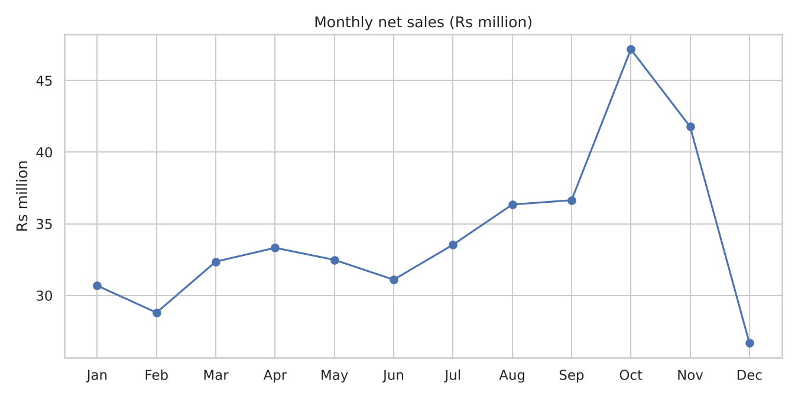
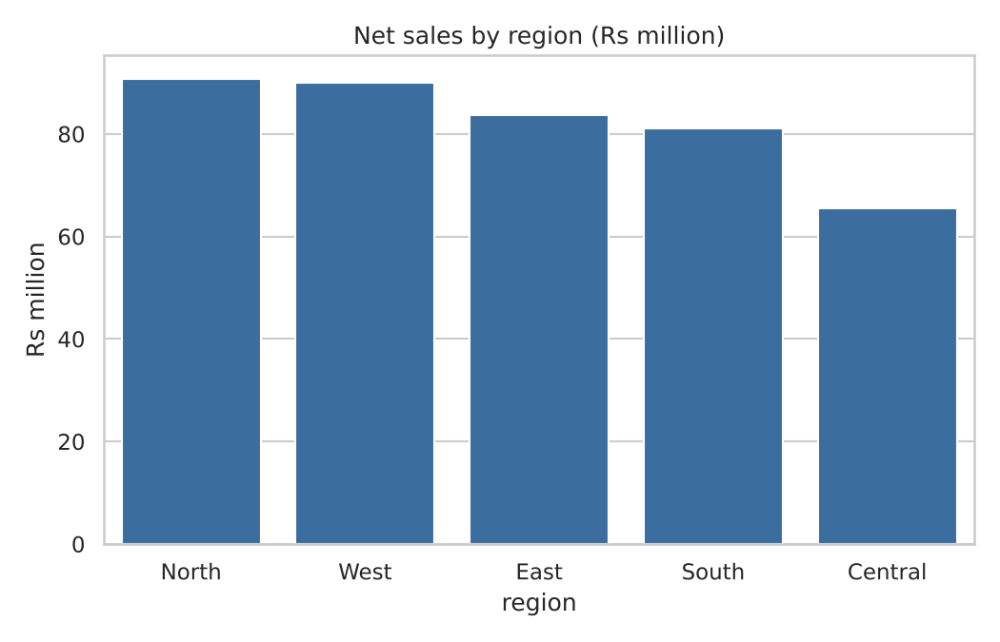
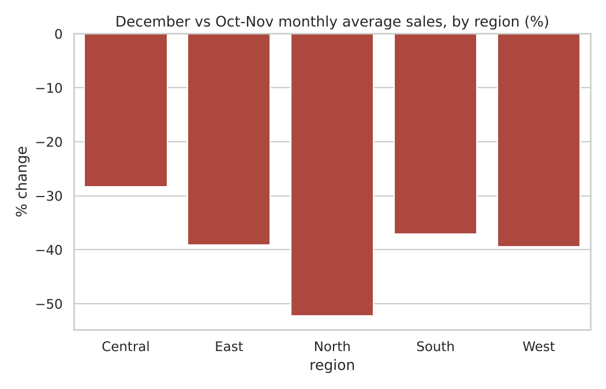
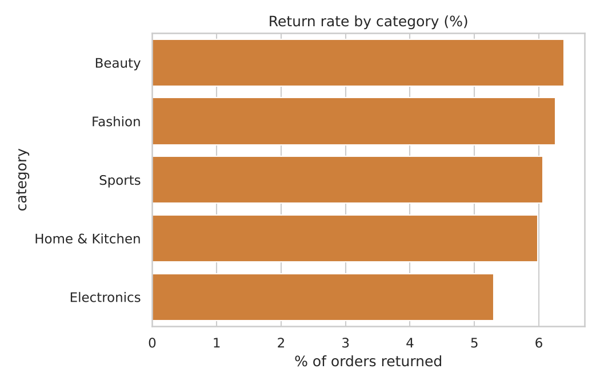

# Sales Dashboard for Regional Performance (SQL + Power BI)

An end-to-end analytics project: PostgreSQL for joining and shaping the data, Power BI for an interactive multipage dashboard.

> **Data note:** the dataset is **synthetic**, generated by `generate_data.py` (25,000 orders, 12 months of 2024, 5 regions, 40 products, with a festival-season sales pattern). It is not real company data.

## Business questions
- Which regions and categories drive sales, and how does each trend month to month?
- How does sales behave after the festival season (Oct-Nov) in each region?
- Where are return rates highest?

## What is in this repo
```
├── generate_data.py          # creates the 3 CSV tables
├── make_charts.py            # KPI charts + findings (Python)
├── export_flat_csv.py        # joins the 3 tables into data/sales_analysis.csv
├── outputs/charts/           # generated preview charts
├── data/                     # orders.csv, products.csv, returns.csv
├── sql/
│   ├── 01_schema.sql         # tables, keys, indexes (PostgreSQL)
│   ├── 02_load_data.sql      # \copy CSVs into the tables
│   ├── 03_analysis_dataset.sql  # JOIN view used by Power BI
│   └── 04_kpi_queries.sql    # window functions, MoM growth, rankings
└── powerbi/
    ├── DAX_measures.md       # 10 measures + page layout guide
    └── screenshots/          # add your dashboard images here
```

## How to run
```bash
pip install pandas numpy
python generate_data.py                       # (CSV files are already included)

createdb sales_dashboard
psql -d sales_dashboard -f sql/01_schema.sql
psql -d sales_dashboard -f sql/02_load_data.sql   # run from the project root
psql -d sales_dashboard -f sql/03_analysis_dataset.sql
psql -d sales_dashboard -f sql/04_kpi_queries.sql
```
Then follow `powerbi/BUILD_STEPS.md` (step by step) and `powerbi/DAX_measures.md` to build the dashboard. Load the single file `data/sales_analysis.csv` (created by `export_flat_csv.py`).

## SQL skills shown
Joins (INNER + LEFT), views, `DATE_TRUNC`, aggregate `FILTER`, window functions (`LAG`, `RANK`, `ROW_NUMBER`, running totals), CTEs, indexes.

## Key findings
Results from the synthetic dataset (SQL queries and `make_charts.py` give the same numbers):

- Total net sales: **Rs 41.09 crore** across **25,000 orders** (average order value about **Rs 16,400**).
- Top region: **North** with **22.1%** of sales; Central is lowest.
- Sales peak in **October** (festival season) and fall **40.0%** in December versus the Oct-Nov monthly average. By region: North -52.2%, West -39.4%, East -39.1%, South -37.1%, Central -28.3%.
- Overall return rate is **6.0%**; **Beauty** has the highest (6.39%) and **Electronics** the lowest (5.30%).

**Recommendations:** plan a December re-engagement campaign (offers, bundles) for North, where the post-festival drop is largest; review product quality and descriptions in Beauty and Fashion to reduce returns.

## Preview charts
Python (Matplotlib) previews of the same KPIs. Build the interactive version in Power BI using `powerbi/DAX_measures.md`.






## Tech stack
PostgreSQL, SQL, Power BI (DAX, Power Query), Python (Pandas, NumPy) for data generation
